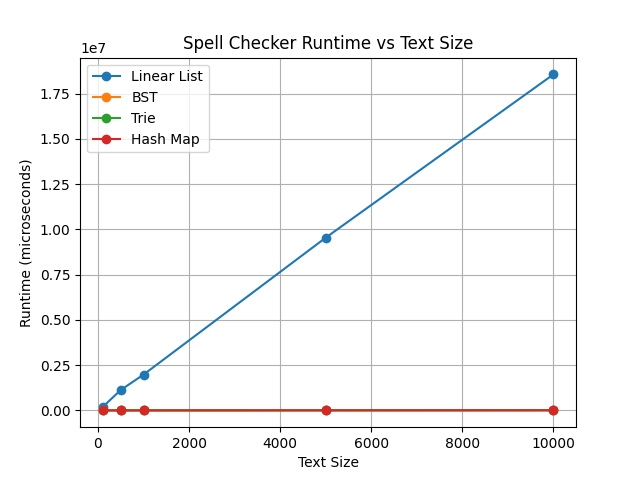
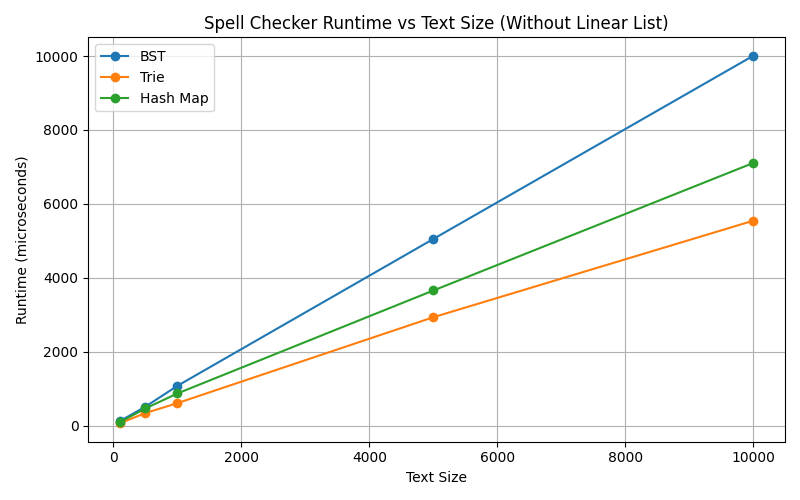
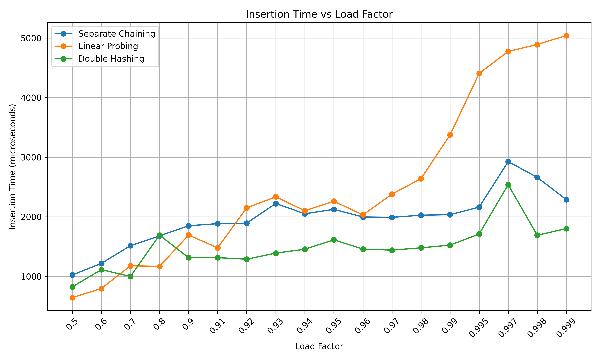
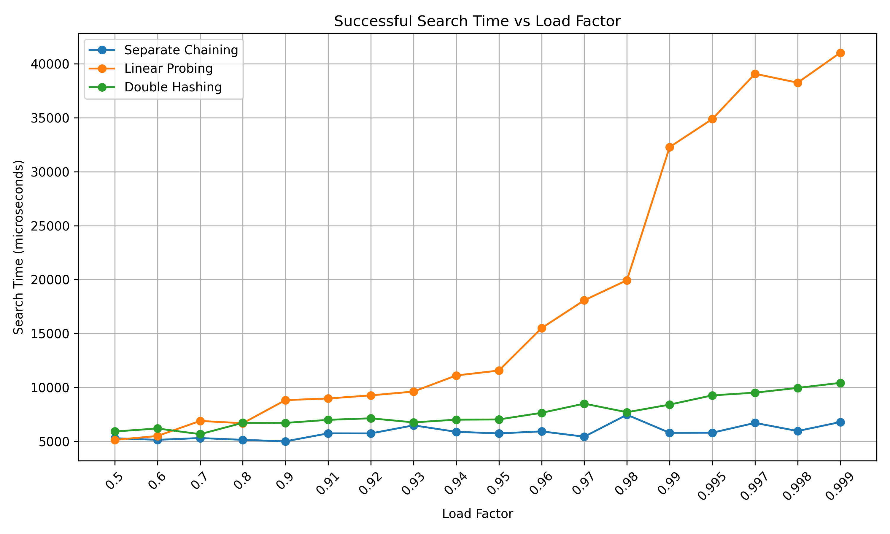
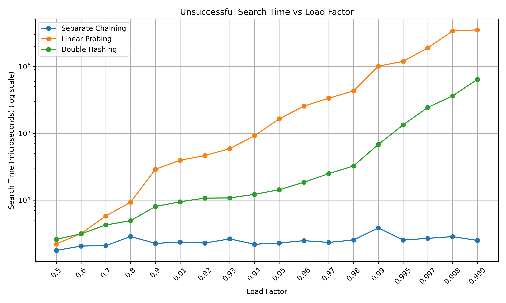
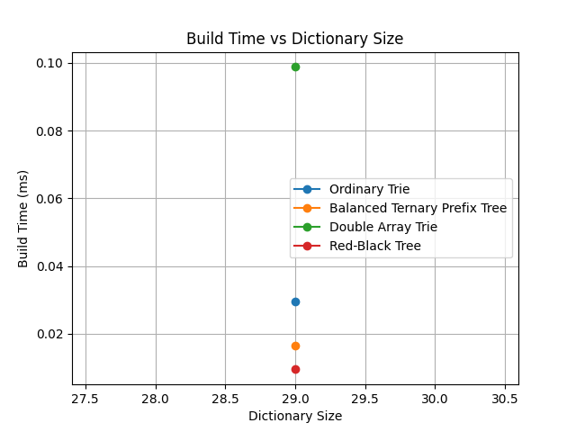
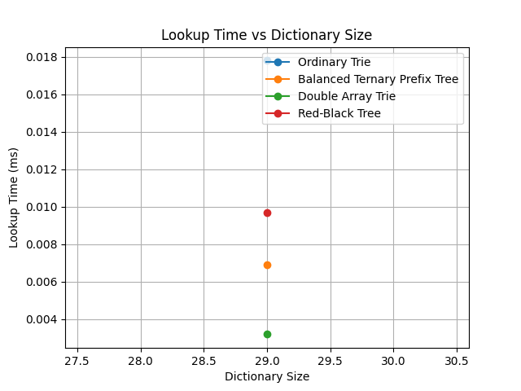
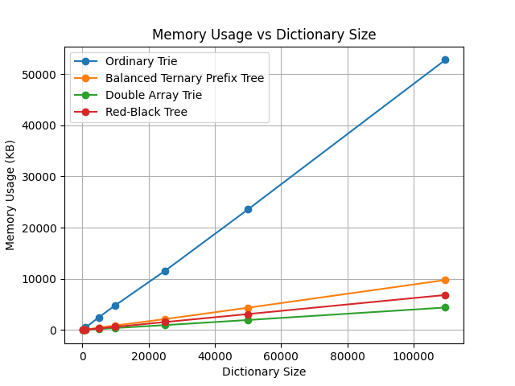

# Data Structures Benchmark

C++17 implementations and benchmarks of dictionary data structures, hash tables and basic graph algorithms. Written for the **Algorithms II** course (Assignment 2) at the University of Łódź.

The goal of the assignment was to compare data structures empirically: implement each one, measure build time, lookup time and memory, and check that the measurements agree with the theoretical complexity.

## Contents

| Folder | Task | Techniques |
|---|---|---|
| `Part1/Part1A` | Spell checker comparing four dictionary structures | Linear list, balanced BST (`std::set`), trie, hash table (`std::unordered_set`) |
| `Part1/Part1B` | Predict which of three wizards reaches a labyrinth exit first | One BFS from the exit over a grid, O(V+E) |
| `Part1/Part1C` | Seat guests at two tables so that nobody sits with someone they dislike | Iterative DFS bipartite check (2-colouring), O(V+E) |
| `Part2` | Hash table collision strategies under increasing load | Separate chaining, linear probing, double hashing, written from scratch |
| `Part3` | Dictionary data-structure comparison on a large word list | Ordinary trie, treap-balanced ternary search tree, double-array trie, red-black tree, all written from scratch |

## Results

### Part 1A: spell-check lookup cost

Time to look up the first N words of a text, in microseconds.

| Text size (words) | Linear list | BST | Trie | Hash |
|---:|---:|---:|---:|---:|
| 100 | 181,749 | 123 | 64 | 94 |
| 1,000 | 1,977,060 | 1,079 | 611 | 873 |
| 10,000 | 18,561,197 | 10,009 | 5,546 | 7,108 |

The linear list's cost grows in proportion to the text size and is about three orders of magnitude slower than the other three at 10,000 words. The trie and hash table are fastest, consistent with O(k) and O(1) average lookups.




### Part 2: hash table load factor

Table size 10,007, load factors from 0.5 to 0.999, 100,000 search operations per measurement. Insert, successful search and unsuccessful search were measured separately for each collision strategy (raw numbers in `Part2/hash_benchmark.csv`).

- **Linear probing** degrades sharply near a full table because of primary clustering. Its unsuccessful-search cost rises from 2,203 at load factor 0.5 to 3,519,561 at 0.999, about 1,600 times higher.
- **Double hashing** also degrades but much less (about 250 times higher over the same range), because probe sequences differ per key.
- **Separate chaining** stays close to flat (1,767 at 0.5, 2,490 at 0.999), because chains stay short even at high load.





### Part 3: dictionary structures on 109,572 words

| Structure | Build (ms) | Lookup batch (ms) | Memory (KB) |
|---|---:|---:|---:|
| Ordinary trie | 101.3 | 0.70 | 52,792 |
| Balanced ternary prefix tree (treap-style) | 97.8 | 1.66 | 9,776 |
| Double-array trie | 311.7 | 1.08 | 6,600 |
| Red-black tree | 298.2 | 8.83 | 6,848 |

Every structure returned all 2,000 present words and none of the absent ones (`correct_hits` = 2000, `wrong_hits` = 0 in `Part3/part3_summary.csv`).

- The ordinary trie is the fastest to build and to search but uses about 8 times more memory than the double-array trie, because every node holds an array of child pointers.
- The double-array trie is the most compact. It pays for that with about 3 times the build time, because it is built offline by freezing a temporary trie into base/check arrays.
- The red-black tree has the slowest lookups, since each comparison is a full string comparison at O(log n) depth.





## Building and running

Requires a C++17 compiler (for example `g++`). Each part reads its input files by relative path, so compile and run from inside the part's folder.

```bash
cd Part1/Part1A
g++ -O2 -std=c++17 main.cpp -o part1a
./part1a            # Windows Command Prompt: part1a
```

The same pattern works for `Part1/Part1B`, `Part1/Part1C`, `Part2` and `Part3`. Notes:

- `Part1A` reads `english_names.txt` (dictionary) and `english_words.txt` (text) and writes `benchmark_results.csv`.
- `Part1B` reads `labyrinth.txt` and `wizards.txt`.
- `Part1C` reads `guests.txt` and `dislikes.txt`.
- `Part2` writes `hash_benchmark.csv`.
- `Part3` reads `English_words.txt` by default (or a path given as the first argument) and writes `part3_results.csv` and `part3_summary.csv`.

The graphs are generated from the CSV files with Python (`pandas`, `matplotlib`):

```bash
pip install pandas matplotlib
python graph.py     # run inside the part's folder
```

## Notes

- Timings come from a single run on one machine and will vary between runs and systems. The ratios between structures are more meaningful than the absolute numbers.
- This is university coursework written to the assignment specification.
